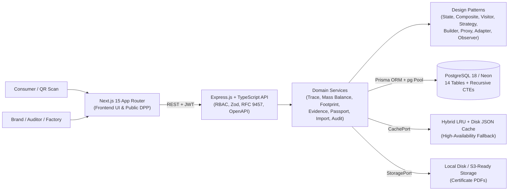

# ThreadTrace — Garment Supply-Chain Traceability & Digital Product Passports (DPP)

[](https://nextjs.org/)
[](https://expressjs.com/)
[](https://www.typescriptlang.org/)
[](https://www.postgresql.org/)
[](https://www.prisma.io/)

**ThreadTrace** is an enterprise B2B garment supply-chain traceability platform and EU ESPR-ready **Digital Product Passport (DPP)** engine. It tracks textile production end-to-end—from spinning mills and fabric dye houses through cutting, sewing, washing, finishing, packing, and export shipping—while enforcing mass-balance rules, verifying organic/recycled sustainability claims against live certificates, rolling up environmental footprints across lot splits and merges, maintaining tamper-evident SHA-256 hash chains, and publishing scannable QR passports with strict multi-tenant confidentiality.

---

## Live Deployments

| Service | URL |
|---|---|
| **Web Application (Next.js)** | https://thread-trace-z2ju.vercel.app/ |
| **Sample Public QR Passport** | https://thread-trace-z2ju.vercel.app/passport/DPP-2026-NW-001 |
| **Sample Claim-Capped Passport** | https://thread-trace-z2ju.vercel.app/passport/DPP-2026-NW-002 |
| **REST API Health Check** | https://thread-trace-alpha.vercel.app/api/v1/health |
| **OpenAPI / Swagger Docs** | https://thread-trace-alpha.vercel.app/api/docs |

---

## Key Capabilities

### 1. Parties, Facilities & Production Lines (`/parties`)
- Register spinning mills, fabric mills, dye houses, wash plants, trims suppliers, export factories, and individual production lines (`CUT`, `SEW`, `WASH_DYE`, `FINISH`, `PACK`).
- Role-based **Audience Proxy** automatically redacts confidential pricing (`unitPriceUsd`), exact factory addresses (`exactAddress`), workforce counts (`workerCount`), and internal contact emails (`contactEmail`) from external views.

### 2. Immutable Lot Ledger, Splits & Merges (`/lots`)
- Record production events (`RECEIVE`, `CUT`, `SEW`, `WASH_DYE`, `FINISH`, `PACK`, `SHIP`, plus custom configured steps) with quantities and units (`KG`, `PIECES`, `CARTONS`).
- Supports **1→N Lot Splits**, **N→1 Lot Merges**, and **Immutable Correction Events** (events are never edited or deleted; corrections append a new event referencing `correctionOfEventId`).
- All lot events are serialized with PostgreSQL row-level locking (`SELECT ... FOR UPDATE`) and linked via a **per-lot SHA-256 hash chain** (`prevHash` → `eventHash`).

### 3. Multi-Tier Backward & Forward Traceability (`/trace`)
- **Backward Trace:** Trace any finished export carton or style code back through every process stage to all source mills and raw material lots.
- **Forward Trace:** Trace any upstream raw yarn or fabric lot forward through splits and merges to every impacted carton, shipment, buyer, and Digital Product Passport.
- Implemented using PostgreSQL `WITH RECURSIVE` CTEs over bidirectionally indexed `lot_edges` (`(parentLotId, childLotId)` and `(childLotId, parentLotId)`).

### 4. Mass Balance & Sustainability Claim Verification (`/compliance`)
- Every transformation validates output weight against input weight minus the configured maximum allowed process loss (e.g., `CUT` ≤ 12% loss), either **blocking** (`422 Unprocessable Entity` RFC 9457 Problem Details) or **flagging** violations.
- Sustainability claims (**Organic %** and **Recycled %**) are rolled up through the supply-chain DAG and **capped at certified lineage input**—unsupported claims can never be published on a passport.
- Automated compliance audit detects over-claimed content, expired certificates, excess process loss, and unlinked orphan lots.

### 5. Certificate Lifecycle & Automatic Claim Revocation (`/evidence`)
- Attach certificates (`GOTS`, `GRS`, `OEKO_TEX`, `ISO_14001`, `LAB_TEST`, or custom types) and lab test reports (PDF/images) to suppliers or lots behind a `StoragePort` abstraction.
- Automated 30-day expiry alert monitoring (`node-cron` + `ExpiryObserver` pattern).
- When a certificate expires or is marked expired, dependent passports are **automatically republished without the expired claim**, and snapshot caches evaluate `validUntil` timestamps in real time.

### 6. Environmental Footprint Roll-Up (`/passports`)
- Aggregates **Water (Liters)**, **Energy (kWh)**, and **Carbon Footprint (kg CO₂e)** per garment across multi-stage splits and merges.
- Configurable allocation strategy via the **Strategy Pattern**: allocate **By Mass (`MASS`)** or **By Piece Count (`PIECE_COUNT`)**.

### 7. Versioned Digital Product Passports & High-Availability Cache (`/passport/[code]`)
- Generates scannable **QR codes**, mobile-first public HTML pages, and public JSON endpoints (`/api/v1/public/passports/:code`) with `ETag` and `Cache-Control` headers.
- **Versioned history (`v1`, `v2`, ...)**: older passport versions remain retrievable.
- **High-Availability Cache Resilience**: backed by `HybridLruDiskCacheAdapter` (`CachePort`), public passports continue serving from local snapshot cache even when the primary PostgreSQL database is unreachable, while still enforcing real-time certificate expiry filtering.

### 8. Multi-Tenant Brand Isolation & Audience Views
- Three distinct audience projections: **Public Consumer**, **Brand Buyer** (`NordicWear AB`, `EuroStyle GmbH`), and **EU Auditor / Factory Admin**.
- Strict cross-brand scoping (`assertBrandAccess`) refuses cross-tenant access attempts with **HTTP 403 Forbidden**.
- Automated confidentiality scanner verifies zero confidential keys leak into public payloads or cached snapshots.

### 9. Bulk Factory CSV & Excel Import (`/imports`)
- Unified **Adapter Pattern** (`CsvImportAdapter` & `ExcelImportAdapter`) ingests daily factory cutting reports and packing lists (`.csv` and `.xlsx`).
- Validates every row against party, lot, and mass-balance rules, committing valid events and reporting rejected rows with line numbers and exact reasons.
- Ready-to-use templates included at `backend/data/samples/`.

### 10. Dynamic Configuration Engine (`/settings`)
- Add or update **Process Steps**, **Loss Limits**, **Enforcement Modes (`BLOCK`/`FLAG`)**, **Emission Factors**, **Certificate Types**, **Default Allocation Strategy**, and **Custom Passport Fields** via configuration alone—no code edits or restarts required.

---

## System Architecture



### Design Patterns Used

| Pattern | Implementation | Purpose |
|---|---|---|
| **State** | `backend/src/patterns/lotState.ts` | Guards legal lot lifecycle transitions (`RECEIVED → IN_PROCESS → SPLIT/MERGED → COMPLETED → SHIPPED / FLAGGED`). |
| **Composite** | `backend/src/patterns/lotComposite.ts` | Models multi-level supply-chain DAG nodes uniformly for traversal and roll-ups. |
| **Visitor** | `backend/src/patterns/lineageVisitor.ts` | `FootprintRollupVisitor` & `ClaimVerificationVisitor` separate calculations from lineage traversal. |
| **Strategy** | `backend/src/patterns/allocationStrategy.ts` | Switches footprint allocation dynamically between `MassAllocationStrategy` and `PieceCountAllocationStrategy`. |
| **Builder** | `backend/src/patterns/passportBuilder.ts` | Assembles versioned passports cleanly with dynamic config-driven custom fields. |
| **Proxy** | `backend/src/patterns/audienceProxy.ts` | Enforces strict Public / Brand / Auditor DTO projections and strips confidential fields. |
| **Adapter** | `backend/src/patterns/importAdapter.ts`, `backend/src/ports/*.port.ts` | Unifies `.csv` / `.xlsx` import parsing, abstracts file storage (`StoragePort`), and abstracts passport caching (`CachePort`). |
| **Observer** | `backend/src/patterns/expiryObserver.ts` | Decouples certificate expiry detection from alert creation and automatic passport claim revocation. |

### Performance Benchmark (200,000 Lots & 2,000,000 Events)

Tested via `npm run benchmark:qa1` on local PostgreSQL 18 across 6 process levels with bidirectional indexes on `lot_edges`:

| Operation | Dataset Size | Measured Latency |
|---|---|---|
| **6-Level Backward Trace** | 200,000 lots · 2,000,000 events | **26.82 ms** |
| **6-Level Forward Trace** | 200,000 lots · 2,000,000 events | **0.74 ms** |

---

## Project Structure

```text
threadtrace/
├── backend/                          # Express + TypeScript + Prisma API (Port 4000)
│   ├── api/index.ts                  # Vercel serverless entrypoint
│   ├── vercel.json                   # Vercel routing configuration
│   ├── prisma/
│   │   ├── schema.prisma             # 14-table relational + DAG + JSONB schema
│   │   └── migrations/
│   ├── data/
│   │   ├── samples/                  # Sample cutting_report_sample.csv & packing_list_sample.xlsx
│   │   ├── uploads/                  # Local evidence PDF storage
│   │   └── passport-cache/           # Local JSON snapshot cache
│   └── src/
│       ├── config/                   # Zod-validated env config & defaults
│       ├── db/                       # PrismaClient singleton & pg.Pool
│       ├── docs/openapi.ts           # OpenAPI 3.0 spec (/api/docs)
│       ├── errors/problemDetails.ts  # RFC 9457 Problem Details error handler
│       ├── middleware/               # Auth JWT, RBAC/brand-scoping, Pino traceId logger
│       ├── patterns/                 # 8 GoF pattern implementations
│       ├── ports/                    # CachePort & StoragePort interfaces/adapters
│       ├── routes/                   # REST controllers (/api/v1/*)
│       ├── services/                 # Core domain services
│       └── scripts/                  # seed-demo.ts, verify-all.ts, benchmark-qa1.ts
└── frontend/                         # Next.js 15 App Router + Tailwind CSS (Port 3000)
    └── src/
        ├── app/
        │   ├── page.tsx              # Executive Dashboard
        │   ├── parties/page.tsx      # Suppliers, Factories & Production Lines
        │   ├── lots/page.tsx         # Lots, Events, Split/Merge & Hash Verification
        │   ├── trace/page.tsx        # Multi-Tier Backward & Forward Trace Viewer
        │   ├── evidence/page.tsx     # Certificates, Alerts & Expiry Control
        │   ├── passports/page.tsx    # Passport Registry, Versions & Audience Views
        │   ├── passport/[code]/      # Mobile-first Public QR Passport Page
        │   ├── imports/page.tsx      # CSV & Excel Bulk Ingestion
        │   ├── compliance/page.tsx   # Compliance Audit & Privacy Scanner
        │   ├── settings/page.tsx     # Dynamic Process, Cert & Field Configuration
        │   └── loading.tsx           # Route transition skeleton
        ├── components/
        │   ├── AppShell.tsx          # Fixed sidebar, live DB status & role switcher
        │   └── Skeleton.tsx          # Reusable shimmer skeleton components
        └── lib/                      # Typed API client & auth context
```

---

## Local Development Setup

### Prerequisites
- **Node.js** 20+ (tested on v26.13.0)
- **PostgreSQL** 16+ (tested on PostgreSQL 18.4)

### 1. Clone Repository
```bash
git clone https://github.com/ashiqurrhmn/ThreadTrace.git
cd ThreadTrace
```

### 2. Configure & Start Backend
```bash
cd backend
cp .env.example .env
# Update DATABASE_URL and JWT_SECRET in .env
npm install
npx prisma migrate deploy
npm run db:seed
npm run dev
```
Backend runs at `http://localhost:4000` (Swagger UI at `http://localhost:4000/api/docs`).

### 3. Configure & Start Frontend
```bash
cd ../frontend
# Create .env.local with: NEXT_PUBLIC_API_URL=http://localhost:4000/api/v1
npm install
npm run dev
```
Frontend runs at `http://localhost:3000`.

### 4. Verification & Scale Benchmark Scripts
```bash
cd backend
npm run typecheck       # TypeScript strict check
npm run verify          # Automated end-to-end suite (mass balance, trace, claims, privacy, cache, hash chain, CSV import, config)
npm run benchmark:qa1   # 200,000 lots + 2,000,000 events recursive trace benchmark
```

---

## Pre-Seeded Accounts & Sample Passports

All accounts use password `Password123!` (or switch instantly via the **View As** bar in the UI):

| Role | Email | Scope |
|---|---|---|
| **EU Auditor** | `auditor@eu-compliance.org` | Full system access, compliance audits, all brands & confidential fields |
| **Factory Admin** | `admin@gazipurknit.bd` | Create lots, record events, split/merge, upload evidence, publish passports |
| **Brand A (NordicWear AB)** | `sourcing@nordicwear.se` | Scoped strictly to NordicWear lots & passports (Sweden) |
| **Brand B (EuroStyle GmbH)** | `sourcing@eurostyle.de` | Scoped strictly to EuroStyle lots & passports (Germany) |
| **Public Consumer** | *(No login required)* | Public QR passport views only (`/passport/DPP-2026-NW-001`) |

---

## Core REST API Endpoints (`/api/v1`)

| Method & Path | Description |
|---|---|
| `GET /health` | System, PostgreSQL reachability & cache status |
| `POST /auth/login` · `POST /auth/demo-switch` | JWT authentication & role switching |
| `GET /parties` · `POST /parties` · `POST /parties/lines` | Suppliers, factories & production lines |
| `GET /lots` · `POST /lots` · `POST /lots/:id/events` | Lots & hash-chained events with mass balance |
| `POST /lots/:id/split` · `POST /lots/merge` | 1→N lot split & N→1 lot merge |
| `GET /lots/:id/footprint` · `GET /lots/:id/verify` | Footprint roll-up & per-lot SHA-256 chain verification |
| `GET /trace/backward/:id` · `GET /trace/forward/:id` | Multi-tier `WITH RECURSIVE` lineage trace |
| `GET /evidences` · `POST /evidences` · `POST /evidences/:id/simulate-expire` | Certificate upload, expiry alerts & claim revocation |
| `GET /public/passports/:code` | Public QR Passport JSON (ETag + offline cache fallback) |
| `GET /passports/:code` · `POST /passports/:code/versions` | Audience-scoped passports & version publishing |
| `POST /imports/upload` | Bulk CSV / `.xlsx` import with row-level validation |
| `GET /audit/defects` · `GET /audit/confidentiality` | Compliance exception & public privacy leak scanners |
| `GET /config` · `PUT /config/*` | Dynamic process steps, cert types & custom passport fields |

---

## Author & Contact

**Ashiqur Rahman**

- **Portfolio:** [ashiqur.me](https://ashiqur.me)
- **LinkedIn:** [linkedin.com/in/ashiqur-rahman00](https://www.linkedin.com/in/ashiqur-rahman00/)
- **GitHub:** [github.com/ashiqurrhmn](https://github.com/ashiqurrhmn)
- **Email:** [ashiqur1312@gmail.com](mailto:ashiqur1312@gmail.com)
